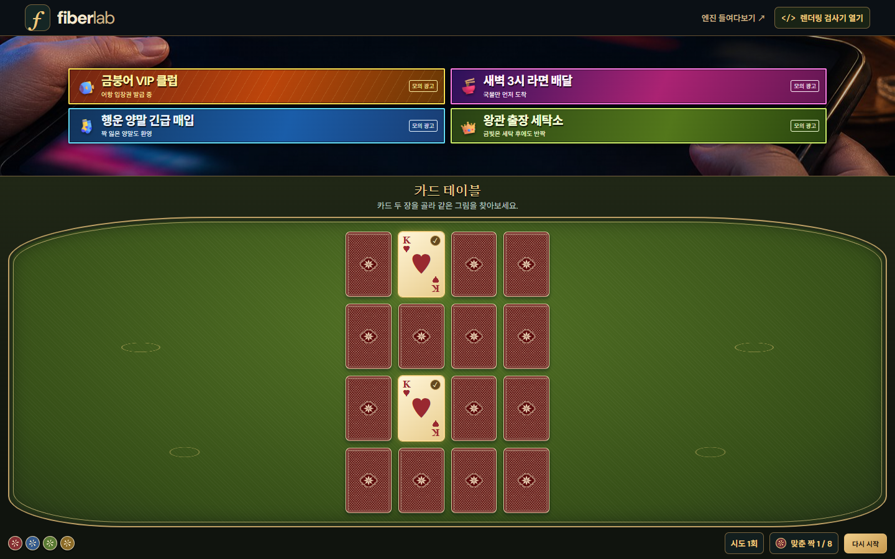
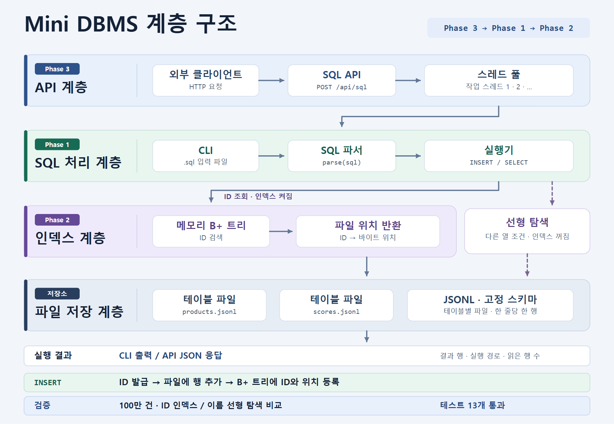

# Mini Systems Lab

**직접 만든 Mini React · Mini Redis · Mini DBMS · POSIX C 웹 서버를 한 저장소에서 실행하고 공부하는 시스템 구현 모음입니다.**

세 원본 저장소의 **브랜치 10개와 고유 커밋 79개**를 커밋 번호 변경 없이 보존했습니다. 통합 `main`에는 실행할 대표 버전을 폴더별로 배치했고, 이전 버전·팀원의 다른 구현은 프로젝트별 원본 보존 브랜치에서 확인할 수 있습니다. 기존 세 저장소는 그대로 유지합니다.

[이력 보존과 브랜치 대응표](docs/MIGRATION.md) · [원본 커밋 목록](docs/import-manifest.json) · [실행 검증](docs/VERIFICATION.md) · [GitHub Actions](https://github.com/kuk-hwan/mini-systems-lab/actions)

## 프로젝트 둘러보기

| 프로젝트 | 직접 구현한 핵심 | 실행 결과 | 자세한 설명 |
|---|---|---|---|
| `mini-react-fiber-lab/` | Virtual DOM, Diff·Patch, Fiber, State, Hooks, Batching | 4×4 카드 짝 맞추기와 렌더링 검사기 | [React README](mini-react-fiber-lab/README.md) |
| `mini-redis/` | 해시 테이블, TTL, 원자적 카운터, 캐시 무효화, 스냅샷 | 시간 제한 퀴즈·힌트·결과 목록 HIT/MISS | [Redis README](mini-redis/README.md) |
| `mini-dbms/` | SQL 파서, JSONL 저장, 메모리 B+ 트리, 스레드 풀 | CLI SQL 처리와 SQL API | [DBMS README](mini-dbms/README.md) |
| `mini-webserver/` | POSIX 소켓, HTTP 파서, 정적 파일, 스레드 풀, Reverse Proxy | 실제 요청 데모와 A/B 백엔드 중계 | [C 웹 서버 README](mini-webserver/README.md) |

프로젝트들은 각각 독립적으로 실행합니다. Redis 퀴즈의 SQLite 점수 저장소는 퀴즈의 데이터 보관용이며, 직접 만든 Mini DBMS와는 별개입니다.

```text
mini-systems-lab/
├── mini-react-fiber-lab/    TypeScript · 카드 게임 · 렌더링 검사기
├── mini-redis/              Python · 캐시 엔진 · 퀴즈
├── mini-dbms/               Python · SQL · B+ 트리 · API
├── mini-webserver/          C · HTTP 서버 · Reverse Proxy
├── docs/                   통합 경위 · 원본 이력 · 검증 기록
└── scripts/                이력 검증 · 전체 검사 명령
```

## 빠른 시작

```sh
git clone https://github.com/kuk-hwan/mini-systems-lab.git
cd mini-systems-lab
```

### 1. Mini React · 카드 짝 맞추기

Node.js 24와 npm을 사용합니다. 저장소 루트에서 실행합니다.

```sh
cd mini-react-fiber-lab
npm ci
npm run dev
```

[http://127.0.0.1:5173](http://127.0.0.1:5173)에서 카드를 고르고 오른쪽 위 **렌더링 검사기**를 열어 상태 변경 → Diff → 실제 DOM 변경을 확인합니다.



### 2. Mini Redis · 시간 제한 퀴즈

Python 3.11 이상에서 저장소 루트를 기준으로 실행합니다.

```sh
python mini-redis/server.py --port 8787
```

[http://127.0.0.1:8787](http://127.0.0.1:8787)에서 문제를 풀며 **힌트 TTL·문제당 1회 조회·한 번만 5초 연장·최근 결과의 HIT/MISS**를 확인합니다. 통합본은 React 저장소 안에 있던 최신 퀴즈 개선분도 가져왔습니다.

### 3. Mini DBMS · SQL 실행과 API

새 터미널에서 저장소 루트를 기준으로 실행합니다.

```sh
cd mini-dbms
python -m mini_dbms.cli examples/demo.sql
python -m mini_dbms.server --port 8796 --workers 4
```

CLI는 먼저 실행 후 종료하고 API 서버를 시작합니다. 같은 데이터 폴더를 여러 프로세스에서 동시에 열지 않습니다. API 예제와 인덱스/선형 탐색 비교는 [DBMS README](mini-dbms/README.md)에 있습니다.



### 4. C 웹 서버 · Reverse Proxy

Linux·macOS 또는 WSL2 Ubuntu에서 저장소 루트를 기준으로 실행합니다.

```sh
cd mini-webserver
make
./build/mini-webserver --port 8080 --root public
```

[http://localhost:8080](http://localhost:8080)에서 정적 페이지·상태 조회·POST·오류 응답을 확인합니다. 백엔드 두 개를 연결하는 [Reverse Proxy 실행 방법](mini-webserver/README.md#reverse-proxy와-ab-백엔드-실행)도 제공합니다.

## 한 곳에서 검사하기

React 폴더의 `npm ci`를 먼저 완료한 뒤 저장소 루트에서 실행합니다.

```sh
python scripts/check_all.py

# 실제 데스크톱·모바일 Chromium까지 검사
cd mini-react-fiber-lab
npx playwright install chromium
cd ..
python scripts/check_all.py --e2e
```

Windows의 C 검사는 설치된 WSL2 Ubuntu와 `make`·C 컴파일러를 사용합니다. Linux/macOS는 POSIX 도구를 직접 사용합니다. `--skip-c`는 해당 도구가 없는 환경에서 나머지만 검사할 때 사용하며, C 검사 통과를 의미하지 않습니다.

이력만 확인하려면 다음 명령을 사용합니다.

```sh
python scripts/verify_history.py --fsck
python scripts/verify_history.py --remote origin --fsck
```

두 번째 명령은 GitHub의 브랜치도 원래 커밋 번호와 일치하는지 확인합니다. 일반 clone은 원본 보존 브랜치를 `origin/react/*` 등의 원격 추적 참조로 가져오며, 검증 스크립트는 이 형태도 확인합니다.

## 어떤 브랜치를 사용하면 되나요?

- **실행·새 개발:** `main`에서 시작합니다.
- **원래 React 저장소:** `react/main`.
- **원래 Redis 저장소:** `redis/main`, `redis/BurningWings`, `redis/CatIsApple`, `redis/feat/kuk-hwan/mini-redis`.
- **원래 DBMS 저장소:** `dbms/main`, `dbms/BurningWings`, `dbms/CatIsApple`, `dbms/kuk-hwan`, `dbms/feat/kuk-hwan/c-web-server`.

원본 보존 브랜치에는 **원래 파일 구조와 원래 커밋**이 있습니다. 통합 `main`의 새 폴더 구조와 다릅니다. 이 브랜치들을 수정하면 보존 검증이 실패하므로 새 기능은 `main`에서 만든 작업 브랜치에 추가합니다.

## 출처와 범위

원본 저장소는 [Mini React](https://github.com/kuk-hwan/mini-react-fiber-lab), [Mini Redis](https://github.com/kuk-hwan/mini-redis), [Mini DBMS](https://github.com/kuk-hwan/mini-DBMS)입니다. 원래 작성자·커미터·메시지·커밋 내용은 그대로 보존합니다. 각 구현의 출처·기존 라이선스는 원래 브랜치와 해당 파일을 기준으로 확인합니다. 통합 작업으로 전체 원본을 새 라이선스로 변경하지 않았습니다.

이번 작업은 Git 코드·브랜치·이력 통합입니다. 원본 GitHub의 이슈·PR·스타·Actions 실행 기록을 새 저장소로 이동한 것은 아닙니다. 기본 테스트 대상은 통합 `main`의 네 프로젝트이며, 보존된 다른 팀 브랜치들의 모든 구현을 다시 검증했다는 뜻은 아닙니다.
