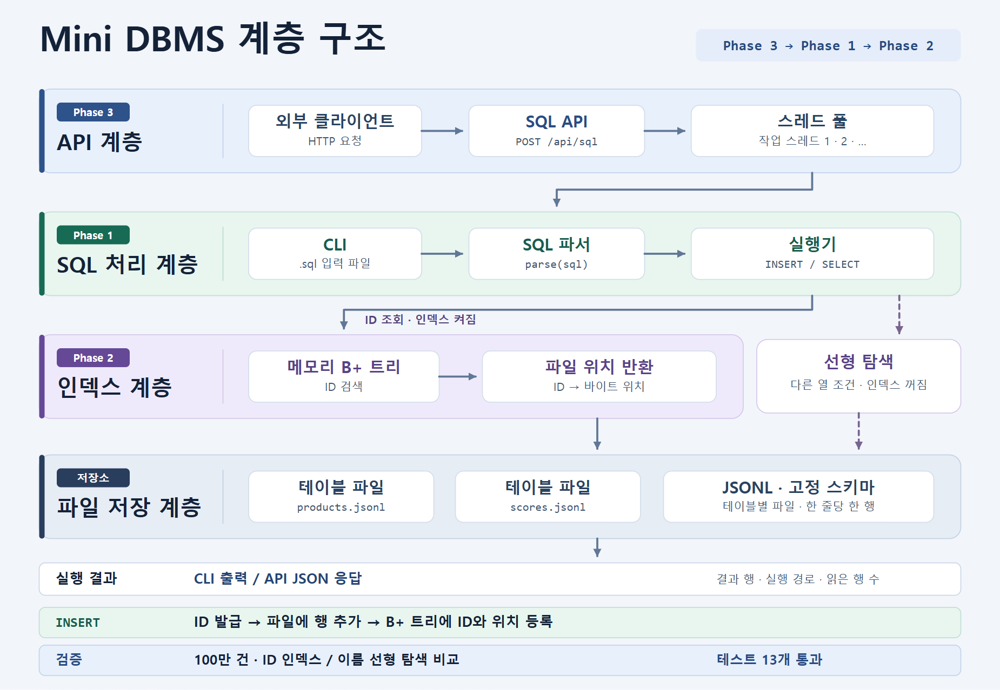

# Mini DBMS

SQL을 직접 파싱하고 실행하는 Python 파일 기반 데이터베이스입니다. Python 3.11 이상과 표준 라이브러리로 실행할 수 있습니다.

## 계층 구조

그림은 API에서 인덱스를 사용하는 ID 조회가 **Phase 3 → Phase 1 → Phase 2 → 파일 저장 계층**을 거치는 순서를 보여줍니다. CLI는 SQL 처리 계층으로 바로 들어갑니다. 인덱스가 적용되지 않는 조회는 오른쪽 선형 탐색 경로를 따라갑니다.

## Phase 1 · SQL 파일 실행

프로젝트 폴더에서 다음 명령을 실행합니다.

~~~powershell
python -m mini_dbms.cli examples/demo.sql
python -m mini_dbms.cli examples/read.sql
~~~

첫 명령은 상품 두 건을 저장하고 조회합니다. 두 번째 명령은 새 프로세스에서 같은 파일을 열어 저장된 행을 읽습니다. 기본 데이터 폴더는 `.data/db`이고, `--data`로 경로를 지정할 수 있습니다.

테이블은 다음 두 개가 준비되어 있습니다. ID는 테이블마다 1부터 자동 발급합니다.

| 테이블 | 열 |
| --- | --- |
| `products` | `id`, `name`(문자열), `price`(정수) |
| `scores` | `id`, `name`(문자열), `score`(정수) |

~~~sql
INSERT INTO scores (name, score) VALUES ('민수', 85);
SELECT name, score FROM scores WHERE id = 1;
SELECT * FROM scores LIMIT 5;
~~~

파일에는 JSON 객체 한 개를 한 줄에 저장합니다. `INSERT`는 행을 파일 끝에 추가한 뒤 동기화하고, `SELECT`는 파일에서 행을 읽어 JSON으로 반환합니다. SQL 범위는 `INSERT`, `SELECT`, 단일 `WHERE … = …`, `LIMIT`과 정수·작은따옴표 문자열입니다. 세미콜론으로 여러 문장을 넘기면 순서대로 각각 실행합니다. 파일 재개 시 맨 끝에서 쓰다 만 줄을 정리하며, 줄 끝이 있는 손상된 레코드는 오류로 보고합니다.

## Phase 2 · B+ 트리 인덱스와 측정

행을 저장할 때 **ID와 그 행의 파일 바이트 위치**를 B+ 트리 리프에 등록합니다. `WHERE id = 2`는 트리에서 위치를 찾은 뒤 파일에서 그 행을 읽습니다. `WHERE name = '빵'`은 파일의 행을 순서대로 비교합니다. 메모리에 있는 트리는 프로그램을 다시 열 때 파일을 읽어 재구성합니다.

| 출력 필드 | 의미 |
| --- | --- |
| `plan` | `B+TREE` 또는 `FULL_SCAN` |
| `rows_examined` | 테이블 파일에서 읽은 행 수 |
| `index_nodes_visited` | B+ 트리에서 방문한 노드 수 |
| `elapsed_ms` | 해당 SQL 실행 시간 |

CLI에 `--scan`을 붙이면 같은 ID 조회도 선형 탐색으로 비교할 수 있습니다.

~~~powershell
python -m mini_dbms.benchmark --rows 1000000 --repeats 5 --output reports/benchmark.json
~~~

실험은 임시 DB에 **100만 행**을 넣고 마지막 행을 ID 인덱스, 이름 선형 탐색, ID 선형 탐색으로 각각 찾습니다. 세 경로에서 같은 행이 나오는지 확인한 뒤 워밍업과 반복 측정을 진행합니다. 삽입 측정은 SQL 파서와 파일 저장 로직을 공유하고, 파일 동기화는 10,000건씩 묶어서 합니다. [이 환경에서 측정한 결과](reports/benchmark.json)

## Phase 3 · Thread Pool API 서버

CLI가 종료된 뒤 같은 폴더에서 실행합니다.

~~~powershell
python -m mini_dbms.server --port 8796 --workers 4
~~~

다른 PowerShell 창에서 SQL을 보내면 됩니다.

~~~powershell
$query = @{ sql = 'SELECT * FROM products WHERE id = 2' } | ConvertTo-Json
Invoke-RestMethod -Uri http://127.0.0.1:8796/api/sql -Method Post -ContentType 'application/json' -Body $query |
  ConvertTo-Json -Depth 8
~~~

`POST /api/sql`은 CLI와 같은 `Database.execute()`를 호출합니다. 응답의 `worker`는 요청을 맡은 스레드 이름입니다. `GET /api/stats`에서는 테이블별 인덱스 높이와 행 수를 볼 수 있습니다. `use_index: false`를 SQL 요청에 함께 보내면 선형 탐색으로 비교할 수 있습니다.

스레드 풀은 여러 요청을 처리합니다. 같은 테이블의 **ID 발급, 파일 쓰기, 인덱스 등록**은 한 번에 한 스레드만 수행하고, 읽기 요청은 자기 차례에 확정된 범위에서 파일을 읽습니다. 인덱스 일관성을 위해 데이터 디렉터리 하나는 한 프로세스가 소유합니다. CLI와 API를 동시에 실행할 때는 다른 `--data` 경로를 지정할 수 있습니다.

## 테스트와 코드

~~~powershell
python -m unittest discover -s tests -v
~~~

- [SQL 파서](mini_dbms/sql.py)에서 SQL이 어떤 명령과 값으로 나뉘는지 볼 수 있습니다.
- [실행기와 파일 저장소](mini_dbms/database.py)에서 행 추가, 파일 읽기, 인덱스 조회를 볼 수 있습니다.
- [B+ 트리](mini_dbms/bptree.py)에서 노드 분할과 ID 탐색을 볼 수 있습니다.
- [HTTP 서버](mini_dbms/server.py)에서 작업 스레드로 요청을 넘기는 과정을 볼 수 있습니다.
