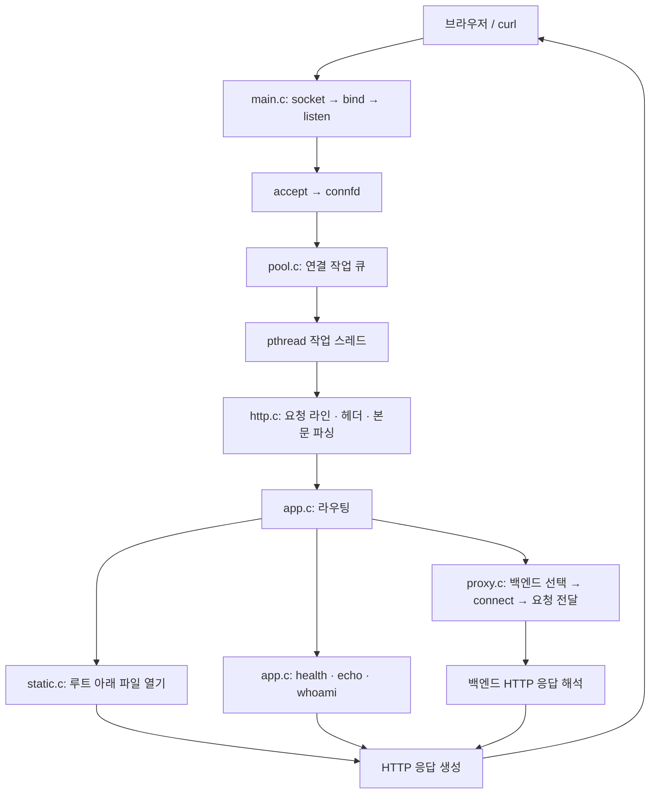

# Socket Lab · C Web Server

C11과 POSIX API로 직접 구현한 **HTTP/1.0·HTTP/1.1 웹 서버 + Reverse Proxy**입니다. 웹 서버 실행에는 외부 HTTP 라이브러리나 프레임워크가 필요하지 않습니다. 같은 저장소의 `mini-dbms`와 독립적으로 실행하며, DBMS를 실행하지 않아도 빌드·테스트·데모를 사용할 수 있습니다.

## 바로 실행하기

Windows에서는 **WSL2 Ubuntu 안에서** 아래 명령을 실행합니다. Linux에서도 동일합니다. macOS에서는 Xcode Command Line Tools와 Python 3를 준비합니다.

```sh
# Ubuntu / WSL2 최초 준비
sudo apt-get update
sudo apt-get install -y build-essential python3 curl

cd mini-webserver
make
./build/mini-webserver --host 127.0.0.1 --port 8080 --root public
```

브라우저에서 [http://localhost:8080](http://localhost:8080)을 열면 실제 요청을 보내는 데모를 볼 수 있습니다. 서버 상태, 없는 파일의 404, POST 본문 되돌려받기를 확인할 수 있습니다. 외부 장치에서 접근하려면 `--host 0.0.0.0`과 해당 환경의 방화벽·포트 전달 설정을 사용합니다. 기본값은 로컬 개발용입니다.

```sh
curl -i http://localhost:8080/
curl -i http://localhost:8080/health
curl -i -X POST http://localhost:8080/api/echo --data-binary 'Hello, POSIX!'
curl -i http://localhost:8080/missing-file
```

## Reverse Proxy와 A/B 백엔드 실행

`mini-webserver` 폴더에서 터미널 세 개를 열어 각각 실행합니다. 백엔드도 같은 C 실행 파일입니다.

```sh
# 터미널 1: 백엔드 A
./build/mini-webserver --port 8001 --root public --name backend-A

# 터미널 2: 백엔드 B
./build/mini-webserver --port 8002 --root public --name backend-B

# 터미널 3: 앞단 Reverse Proxy
./build/mini-webserver --port 8080 --root public --workers 8 \
  --route '/api/=127.0.0.1:8001,127.0.0.1:8002'
```

8080번 데모 페이지의 **어느 백엔드일까요?**를 여러 번 누르면 `backend-A`, `backend-B`가 번갈아 나옵니다. 처음 선택되는 서버는 앞서 보낸 `/api/*` 요청 수에 따라 달라집니다. 동시에 요청하면 응답 완료 순서는 선택 순서와 달라질 수 있습니다.

```sh
curl -s http://localhost:8080/api/whoami
curl -s http://localhost:8080/api/whoami
curl -i -X POST http://localhost:8080/api/echo --data-binary 'forwarded body'
```

경로를 유지해서 전달합니다. `/api/whoami?q=1`은 백엔드에도 같은 경로·쿼리로 전달됩니다. 라우트는 여러 번 지정할 수 있고 가장 긴 경로 접두사가 우선합니다. `/service`는 `/service-other`에 매칭되지 않습니다. `/api/`는 `/api`와 구분됩니다.

```sh
./build/mini-webserver --port 8080 --root public \
  --route '/api/=127.0.0.1:8001,127.0.0.1:8002' \
  --route '/api/admin/=127.0.0.1:8002'
```

라우트가 없는 경로는 서버의 로컬 동적 엔드포인트 또는 정적 루트에서 처리합니다. `/`와 CSS·JS·SVG는 C 서버가 직접 서빙합니다. Forward Proxy·CONNECT 터널은 구현 범위에 포함하지 않습니다. 과제에서 요구한 두 종류 중 **Reverse Proxy**를 구현한 것입니다.

## 한 요청의 실제 코드 흐름



`socket/bind/listen`은 시작할 때 실행합니다. `accept`는 새 연결마다 실행하고, 작업 큐에는 그 연결의 `connfd`를 넣습니다. 스레드 하나는 연결을 맡아 요청을 처리합니다. HTTP/1.1 keep-alive에서는 같은 연결에서 다음 요청을 읽고, 최대 100개 또는 종료·시간 제한 조건에서 연결을 닫습니다. 따라서 **연결 하나와 요청 하나는 항상 같은 개념이 아닙니다.**

프록시는 클라이언트 측 `connfd` 외에 백엔드 연결 FD도 소유합니다. 백엔드에는 `Connection: close`를 사용하고 요청마다 새 연결을 만듭니다. 클라이언트 연결은 재사용할 수 있습니다. 백엔드 연결 풀은 아직 구현하지 않았습니다.

## 파일별 역할

| 파일 | 핵심 함수 | 맡은 일 |
|---|---|---|
| `src/main.c` | `main`, `on_signal` | 서버 시작, accept 루프, self-pipe 종료 신호 처리 |
| `src/net.c` | `net_listen`, `net_connect`, `send_all`, `stream_*` | 소켓·부분 읽기/쓰기·절대 시간 제한 |
| `src/pool.c` | `pool_submit`, `worker`, `pool_stop` | 제한된 연결 큐·작업 스레드·종료 |
| `src/http.c` | `read_request`, `parse_request_head`, `parse_headers`, `response_*` | HTTP 파싱·프레이밍·응답 생성 |
| `src/config.c` | `config_init`, `route_match`, `route_next` | CLI, 최장 접두사 라우팅, 라운드 로빈 |
| `src/static.c` | `decode_path`, `static_open`, `serve_static`, `mime_type` | 파일 경로 검증·MIME·정적 응답 |
| `src/proxy.c` | `serve_proxy` | 백엔드 연결·요청 재작성·응답 프레이밍 처리 |
| `src/app.c` | `handle_connection` | 요청별 분기·keep-alive 루프·동적 데모 |
| `include/web.h` | 공통 타입·한도·함수 선언 | 모듈 간 인터페이스 |
| `public/` | HTML·CSS·Vanilla JavaScript | 실제 C API에 요청하는 정적 데모 |

## 중점 포인트와 구현 판단

| 과제 포인트 | 구현 내용 |
|---|---|
| TCP·3-way handshake | 커널 TCP가 연결을 수립하고 애플리케이션은 `connect`·`accept`로 이용합니다. `accept` 자체가 handshake를 직접 구현하지 않습니다. |
| `SO_REUSEADDR`·bind 실패 | 리스너 생성 시 설정하고, 포트 충돌·잘못된 루트·설정 오류는 비정상 종료 코드로 보고합니다. |
| blocking / non-blocking | FD는 non-blocking입니다. 스레드는 `poll`로 준비 상태를 기다리고 남은 절대 deadline만 사용합니다. 전체 연결을 처리하는 이벤트 루프 모델은 아닙니다. |
| HTTP 경계 | CRLF 줄 경계와 CRLF CRLF 헤더 종료를 직접 해석합니다. TCP 수신 단위와 요청 경계가 같다고 가정하지 않습니다. |
| POST 본문 | Content-Length 바이트만큼 읽습니다. 중간 EOF, 음수·중복·오버플로·과대 길이를 거부합니다. |
| keep-alive | HTTP/1.1은 기본 유지, `Connection: close`는 종료합니다. HTTP/1.0은 명시적 keep-alive만 유지합니다. 읽기 버퍼의 다음 요청 바이트도 보존합니다. |
| `Expect` | `100-continue`를 처리하고 지원하지 않는 기대값은 417로 응답합니다. |
| 동시성 | pthread 고정 스레드 풀·제한된 큐. 큐가 가득 차면 즉시 503을 시도하고 연결을 정리합니다. |
| 라운드 로빈 | 라우트별 mutex로 다음 백엔드를 선택합니다. 네트워크 I/O 중에는 라우트 잠금을 잡지 않습니다. |
| 프록시 헤더 | Host·Content-Length·Connection을 새 연결에 맞게 생성합니다. hop-by-hop 및 Connection에 명시된 헤더를 제거하고 X-Forwarded-For를 실제 연결 주소로 재작성합니다. |
| 백엔드 응답 | Content-Length, chunked, 연결 종료 기반 본문을 처리합니다. chunked는 해제한 뒤 길이가 있는 응답으로 보냅니다. 중복 Set-Cookie는 별도 헤더로 유지합니다. |
| 백엔드 실패 | 연결·프로토콜 오류는 502, 시간 초과는 504. POST 중복 실행을 피하려고 실패 요청을 자동 재전송하지 않습니다. |
| 정적 경로 | URL 디코딩 후 `.`·`..`·NUL·제어 문자를 검사합니다. `openat`과 `O_NOFOLLOW`로 각 경로 요소를 열어 심볼릭 링크를 거부합니다. |
| 메모리·FD | 요청 본문·프록시 버퍼 해제, 파일·연결 FD 닫기. 정상·오류 경로를 sanitizer·valgrind로 검사합니다. |
| SIGPIPE | 무시하고 쓰기 실패를 반환값으로 처리합니다. |
| SIGINT·SIGTERM | handler는 플래그와 self-pipe 쓰기만 수행합니다. 새 접수를 멈추고 큐를 정리하고 진행 중 작업의 deadline 후 스레드를 join합니다. |

## 명시한 HTTP 범위와 한도

- GET·POST·HEAD, HTTP/1.0·1.1, origin-form 경로를 지원합니다.
- 요청 헤더 16 KiB, URI 4096바이트, 헤더 64개, 개별 값 2047바이트, 본문 1 MiB까지 처리합니다.
- POST에는 Content-Length가 필요하며 없으면 411입니다. **chunked 요청 본문**은 501로 거부합니다. TE와 CL 동시 지정·중복 CL·중복 Host는 400입니다.
- 백엔드 응답 본문은 8 MiB까지 메모리에 완성한 뒤 전달합니다. 완성 전 오류에 502/504를 보낼 수 있지만, 대형 파일·스트리밍에는 적합하지 않습니다. chunked 응답의 trailer는 소비하고 전달하지 않습니다.
- 경로 라우트 최대 16개, 라우트별 백엔드 최대 8개, 작업 스레드 1~128개, 큐 1~4096개입니다.
- 기본 요청 처리 deadline 5초, 백엔드 연결·송수신 전체 deadline 3초입니다. 한 바이트씩 보내도 요청 deadline이 매번 연장되지 않습니다.
- 백엔드 주소는 시작할 때 DNS 조회 결과의 첫 주소로 고정합니다. 실행 중 DNS 갱신·다중 주소 fallback·상태 기반 failover는 지원하지 않습니다.
- TLS/HTTPS, HTTP/2·3, WebSocket, HTTP 캐시, Range, 압축 생성, CGI는 구현하지 않았습니다. 동적 요청은 C 로직 또는 백엔드 전달로 충족합니다.
- 고정 작업자 구조에서 느린 keep-alive 연결은 작업자를 차지합니다. 이번 결과를 C10K 달성이나 운영 서비스 수준이라고 주장하지 않습니다. 다음 단계는 이벤트 기반 연결 관리·백엔드 연결 풀·스트리밍입니다.

## 빌드·테스트·검사

서버 자체는 표준 C/POSIX만 사용합니다. 테스트·측정 자동화는 Python 표준 라이브러리를 사용합니다.

```sh
make test           # C 단위 검사 + 실제 소켓 통합 테스트
make smoke          # 실제 curl로 데모 자산·C 백엔드 A/B·UTF-8 POST 확인
make sanitize-test  # ASan + UBSan + 누수 감지로 같은 테스트

# Ubuntu / WSL2에서 추가 검사
sudo apt-get install -y valgrind apache2-utils
make valgrind       # C 프록시와 C 백엔드의 힙·FD 회수 확인
make benchmark      # 실제 ab, static/proxy × c=1/10/50 × keep-alive on/off
```

기본 부하 측정은 연결당 작업자 모델을 고려해 작업자 64개로 진행합니다. `python3 tests/benchmark.py --workers 8`로 작은 풀의 keep-alive 대기를 재현할 수 있습니다. 스크립트는 failed와 non-2xx도 결과에 기록하므로 처리량만으로 성공을 판단하지 않습니다.

테스트에는 분할 수신·이진 POST·100 Continue·연속 keep-alive·파이프라인·디렉터리 탈출·심볼릭 링크·잘못된 길이·큰 헤더·backend chunked·불완전 응답·타임아웃·동시 접속·대기열 초과·클라이언트 강제 종료·SIGINT·FD 회수가 포함됩니다. [실제 측정과 검증 기록](docs/verification.md)을 확인하세요. 벤치마크 값은 실행 환경에 따라 달라집니다.

GitHub Actions에는 Linux/macOS 빌드·통합 테스트와 Linux 메모리 검사 작업을 추가했습니다. 로컬 WSL2 검사와 원격 CI 결과는 구분해서 확인해야 합니다.

## 학습용으로 설명할 수 있어야 할 질문

1. `listenfd`와 `connfd`는 왜 분리되나요?
2. `recv` 한 번으로 HTTP 요청 전체를 받았다고 가정하면 왜 안 되나요?
3. Content-Length가 글자 수가 아니라 바이트 수인 이유는 무엇인가요?
4. 스레드 풀에서 mutex는 어느 구간을 보호하나요?
5. Reverse Proxy가 백엔드에 연결할 때는 왜 클라이언트 역할인가요?
6. keep-alive인 브라우저 연결과 `Connection: close`인 백엔드 연결이 공존할 수 있나요?
7. `realpath` 확인 후 파일을 여는 방식 대신 `openat`을 사용한 이유는 무엇인가요?
8. SIGTERM을 받았을 때 signal handler에서 pthread join을 바로 호출하지 않는 이유는 무엇인가요?

자세한 함수 호출 순서는 [구조와 실행 흐름](docs/architecture.md)에 정리했습니다.

## 참고 규격

과제에 명시된 RFC 7230~7235의 HTTP/1.1 핵심을 바탕으로 범위를 제한했습니다. 메시지 문법·프레이밍은 이를 대체하는 [RFC 9112](https://www.rfc-editor.org/rfc/rfc9112.html), 의미·프록시 헤더 처리는 [RFC 9110](https://www.rfc-editor.org/rfc/rfc9110.html)을 참고했습니다. 모든 HTTP 기능을 구현한 것은 아닙니다.
